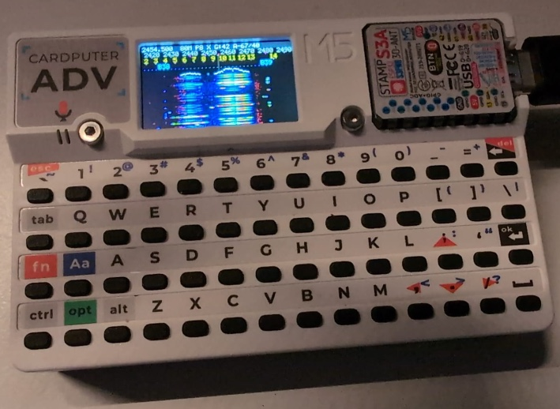

.. SPDX-License-Identifier: GPL-3.0-or-later

ESP-SDR waterfall (M5Stack Cardputer-Adv)
#########################################

.. The path works from here (GitHub) and from doc/apps/waterfall.rst (Sphinx), both two
   levels below the repository root.

         channel numbers over the trace
   :width: 480

A receive-only spectrum and waterfall on the Cardputer-Adv's 240x135 display, in plain C:
no MicroPython, no LVGL, no PSRAM (the Stamp-S3A has none).

Each row is a Welch average of Hann-windowed 1024-point FFTs over one 4096-sample burst at
16, 40 or 80 MS/s. The up and down keys step the screen's span through 1000, 640, 320, 160,
80, 40, 16, 8, 4 and 2 MHz (80 and wider sweep, below): 40 MHz captures at 80 MS/s, 16 and 8 MHz
at 40 MS/s, 4 and 2 MHz at 16 MS/s
(each showing part of the capture). The radio's analog filters pass about +-10 MHz at 16 MS/s and,
in the PHY's 40 MHz mode used at 40 and 80 MS/s, about +-18 MHz, so the outer parts of a wide
view are attenuated. At 16 MS/s that is wider than the capture itself: whatever lies 8 to
10 MHz out folds back in at the other edge (Wi-Fi at 2402 MHz showed 21 dB up at 2386 when
tuned to 2393), which is why 16 and 8 MHz are captured at 40 MS/s (39 kHz bins, about the
pixels' width at 8 MHz) and 4 and 2 MHz keep to the middle of their capture. At 40 MS/s the
filters' slow roll-off past +-18 MHz does the same at the edges (a mast at 2675 MHz showed at
2635 when tuned to 2655), so 40 MHz is captured at 80 MS/s; each pixel takes the strongest bin under it. Below 16 MHz, time resolution
grows with the frequency resolution: the screen is redrawn after 2, 4 or 8 captured rows
instead of one, each taking its share of the peak hold's bursts (8 at 16 MHz, 1 each at
2 MHz), so the waterfall scrolls at about the same speed with more detail.
Scrolling past the captured span retunes the radio, and the waterfall history is shifted and
rescaled to stay lined up.

The spans of 80 MHz and wider sweep: each row retunes across the view in steps of at most
32 MHz (3 at 80 MHz, 5 at 160, 32 for the whole 1000 MHz from 1800 to 2800), captures 4096 samples at
80 MS/s at each and keeps the middle of each step, inside the filters' passband, so the band
plan shows at a glance (the band names fit). The library waits 3 ms after every retune by
default; after a reset, captures right after a 40 MHz hop matched settled ones with no wait at
all (passband within 0.15 dB, clock harmonics 0.5 dB), but after some power-ons the first 500 us or so
make spurs up to +32 dB, smeared over several bins, so the app sets 1 ms
(``esp_sdr_set_retune_settle()``). The P
bursts of a row are shared out over the steps (at least one each), so a row is as much work
as elsewhere and the scroll speed falls smoothly with the width (rows a second):

==========  ====  ===  ===  ===  ===  ===  ===  ===  ===  ===
Span (MHz)  1000  640  320  160   80   40   16    8    4    2
==========  ====  ===  ===  ===  ===  ===  ===  ===  ===  ===
``P8``         4    7   12   15   18   22   21   41   68  109
``P1``         4    7   12   19   25   37   37   62   84  109
==========  ====  ===  ===  ===  ===  ===  ===  ===  ===  ===

At 320 MHz and wider a step gets one burst, so short bursts are often missed there.
``$settle`` changes the wait after each retune, for experiments.

The FFTs are esp-dsp's ESP32-S3 kernel (west project ``esp-dsp``, checked against the C
FFT at boot): 0.4 ms for 1024 points, and a burst takes about 2.9 ms in all. The display
runs at 80 MHz SPI (above the ST7789's rated 62.5 MHz writes, but clean here), so a whole
redraw takes about 6.5 ms, and landscape redraws after every row: redrawn at a frame rate, the
waterfall stepped by one row or two at a time, unevenly, which shimmered. At 16 MHz that is
about 21 rows a second with peak hold (``P8``) and 37 with one burst a row (``P1``); the table
under ``p`` has the rest.

Held upright (either edge down, past about 60 degrees; back to landscape within about 30 degrees
of upright, so it does not flip back and forth), the BMI270 accelerometer switches to a portrait
layout laid out as the landscape one: the settings on two lines, the scale, and the trace with
the Wi-Fi and Bluetooth LE labels on top, the waterfall under them with the newest row at the
top. The panel scrolls the waterfall in hardware, so a new row costs one 135-pixel column
instead of a redraw: about 35 rows a second at ``P8`` and 128 at ``P1``, against 21 and 37 in
landscape. The arrow keys follow the
rotation (left and right still scroll, up and down still step the span as seen on the screen);
``v`` turns the automatic rotation off and on. The key list stays in landscape.

Wi-Fi is bursty and one burst is only 256 us (16 MS/s) to 51 us (80 MS/s), so by default
each row is the per-bin maximum over 8 bursts (peak hold, ``P8`` in the header). ``p`` sets
the speed: each press halves the bursts per row, 8, 4, 2, 1 (one burst's plain average), then
wraps round to the slow end, 32 and 16. Fewer bursts scroll faster but miss more of short
bursts; 16 and 32 catch more and hold more seconds of history. Rows a second at 16 MHz, in
landscape (portrait is faster, the waterfall scrolling in hardware):

==========  ===  ===  ===  ===  ===  ===
Bursts       32   16    8    4    2    1
==========  ===  ===  ===  ===  ===  ===
Landscape     8   14   21   28   33   37
Portrait     10   19   35   59   93  128
==========  ===  ===  ===  ===  ===  ===

The top line shows the view's centre frequency, span, gain and colour scale; under
it a frequency scale with ticks (taller on whole MHz) and their values in MHz where they
fit. A white mark under the scale is the view centre; a red one is where the radio is tuned,
which has a narrow artefact of its own (LO leakage, patched over, with a skirt of about
+-110 kHz) to ignore. Zoomed in to 8, 4 or 2 MHz the radio tunes just below the view instead
(offset tuning, 1 MHz below), so that line is off the screen. The
receiver also makes a spur that moves with the LO, at LO + (LO - 2400 MHz) / 3 (2386.67 MHz
when tuned to 2390): offset tuning goes above the view instead when below would put it on
the screen. Scrolling keeps the tuning while it still serves (the view inside the capture,
the LO and its spur off it), so at 4 and 2 MHz most steps do not retune.

The receiver makes more narrow lines of its own: the board's clock harmonics (multiples of
the 40 MHz crystal and the 48 MHz USB clock: 2352, 2360, 2400, 2440, 2448, 2496 MHz and
more), and spurs that move with the LO in ways no formula covers, more of them under
1842 MHz, some there only now and then. They are all narrow, so ``x`` (on at start, ``W`` in
the header) clears narrow lines, blind: in every row, a run of bins more than 4 dB above the
mean of a ring of bins one to three widths out is cleared, with its skirts, to that mean when
the run is no wider than 600 kHz (``$width <kHz> <dB>`` to experiment; under 1842 MHz the
spur cluster wanders over most of 1 MHz). It needs no learning or table and takes lines that
come and go too, but it also takes real narrow signals (NB-IoT and GSM carriers, 180 and
200 kHz, and anything narrower); Wi-Fi, Bluetooth and 4G are wider and stay; ``x`` again
shows everything. In the sweeps it leaves no steady line at 160 MHz (8 without), and over 50
tunings of the 40 MHz span it left 0.9 narrow peaks above 6 dB a view against 3.7, half as
many as a learned per-tuning mask with a measured spur list did (since removed, with the
magenta clock marks on the scale).

Every capture also carries the receiver's own shape about the LO: the analog filters'
roll-off (-1 dB at 15 MHz from the LO at 80 MS/s, -2.7 at 20), a broad bump of up to +3 dB
within a few hundred kHz of the LO, and a gentle rise towards the edges at 40 and 16 MS/s.
Measured at 48 tunings from 1801 to 2788 MHz it is the same at every one (within 0.2 to
0.4 dB), cold or after hours, and nearly the same at every gain, so ``f`` (on at start, ``F``
in the header) divides it out with a table per capture rate and gain set (up to 35, up to 55,
above), built from those measurements (``src/flat_tables.h``, `Calibration`_). At gains 20
and 42 the background is then flat within 0.4 dB (1 MHz averages) where it varied by about
4 dB; at 70 within about 1 dB. In the sweeps the shape used to repeat at every 32 MHz step
(a "mowed lawn" of about 3.7 dB); it is down to about 1.7, the noise of the measurement.

The 40 MHz span stays one capture: swept in two halves, a burst that began or ended between
them showed in only one, torn at the seam. Every span now stays inside the filters, so nothing
is dimmed. The display refreshes at 119 Hz, twice its default: with no tearing-effect line wired to
time writes against, the panel's scan crosses what is being drawn in most frames, which at
60 Hz showed as a shimmer over the waterfall and trace; at 119 Hz it is gone in portrait.
Landscape's shimmer was mostly the uneven steps of a redraw at a frame rate (above); it is
redrawn after every row now.
Below come a 30 pixel spectrum trace and the
waterfall, newest row on top. A ``!`` after the frequency means the PLL reported the
frequency outside its tuning window (``-ERANGE``).

Build and flash
***************

The board is ``m5stack_stamps3/esp32s3/procpu`` with this repository's
``m5stack_cardputer_adv`` shield (added automatically for that board)::

   west build -b m5stack_stamps3/esp32s3/procpu esp-sdr-zephyr/apps/waterfall
   west flash

The Stamp-S3A flashes over its USB Serial/JTAG port; if it does not enumerate, enter download
mode: power switch off, hold G0, power on.

Keys
****

======  ===========================================
Key     Action
======  ===========================================
Esc     show / hide the key list on screen (the `` ` `` key; any
        other key also closes it)
``,``   scroll left by 1/8 screen (left arrow)
``/``   scroll right by 1/8 screen (right arrow)
``;``   narrower span, down to 2 MHz (up arrow)
``.``   wider span, up to 1000 MHz swept (down arrow)
``h``   back to 2440 MHz, 16 MHz span
``1``   to ``9`` and ``0``: jump to a band (table below)
``-``   darker: colour floor +2 dB (manual)
``=``   brighter (``+``): colour floor -2 dB (manual)
``[``   colour range -5 dB
``]``   colour range +5 dB
``a``   automatic colour floor on / off
``w``   2.4 GHz Wi-Fi channel overlay on / off
``p``   speed: bursts per row (peak hold), 8 (at start), 4, 2, 1, 32, 16
``x``   clear narrow lines, the receiver's own among them (``W``, on at start)
``f``   flatten the receiver's own shape on / off (on at start)
``n``   gain -1 (default fixed 42; AGC hides bursty Wi-Fi)
``m``   fixed gain +1
``g``   AGC
``v``   automatic portrait layout when held upright on / off
======  ===========================================

Wi-Fi channels 1 to 12 are always labelled at the top of the spectrum trace, each number
centred over a short tick at the channel centre (labels that would collide are skipped).
Below them, the Bluetooth LE advertising channels are labelled ``B37``, ``B38`` and ``B39``
in cyan (2402, 2426 and 2480 MHz), where BLE devices announce themselves in short bursts; small
dark cyan ticks under them mark the 37 data channels (every 2 MHz from 2404 to 2478 MHz),
which connected devices hop between. The
overlay adds dotted lines through the trace and waterfall (cyan for Bluetooth) and tints the
20 MHz of the non-overlapping Wi-Fi channels 1, 6 and 11 in the trace.

The same row marks the other services in the tuning range, which never overlap 2.4 GHz Wi-Fi:
each band is a coloured line through the middle of the row, broken around its name where it
fits, orange where masts transmit (``4G MAST``), blue where users' phones, tablets and hotspots do (``4G USER``), violet
where both take turns (TDD, ``4G/5G`` for B40 and B38), pink DECT, grey satellites. Where a readable name does not fit
(the band mostly off the screen) its short code shows instead, for example ``B1 DL``. The number keys jump to the bands' centres, in order:

===  ==================================  ==================================
Key  Europe/UK (default)                 US (``$region us``)
===  ==================================  ==================================
1    B3 DL, 4G masts, 1805-1880          B25 UL, phones, 1850-1915
2    DECT cordless phones, 1880-1900     DECT 6.0, 1920-1930
3    B1 UL, 3G/4G phones, 1920-1980      B25 DL, masts, 1930-1995
4    B1 DL, 3G/4G masts, 2110-2170       B66 DL, masts, 2110-2200
5    B40, 4G/5G TDD, 2300-2400           B30 UL, phones, 2305-2315
6    ISM: Wi-Fi, BLE, Zigbee, 2400-2483  SXM, SiriusXM satellite, 2320-2345
7    GSTAR, Globalstar down, 2483-2500   B30 DL, masts, 2350-2360
8    B7 UL, 4G phones, 2500-2570         ISM, 2400-2483
9    B38, 4G TDD, 2570-2620              GSTAR, Globalstar down, 2483-2500
0    B7 DL, 4G masts, 2620-2690          B41, 4G/5G TDD, 2496-2690
===  ==================================  ==================================

The allocations are approximate and vary by country and operator.

The view centre is limited to 1800 to 2800 MHz. The keys also work typed on the USB console.
With ``$text on`` (below) the console prints a ``spec`` line every 2 s: the view, then the 240
pixels' maximum in dB since the previous line, and the rows per second every 5 s. They are off
by default: the screen hitches each time one goes out, a pause every few seconds (the binary
frames, larger and more frequent, do not do it; the cause is not known). Every key press is logged with its raw TCA8418 event on the console,
which helps if the key map needs adjusting.

Host interface
**************

For development the USB console also takes commands, one per line starting with ``$``; each
answers with one ``ok <command> ...`` or ``err <command> ...`` line (``stat ...`` for
``$status``):

====================  ===========================================================
Command               Action
====================  ===========================================================
``$help``             list the commands
``$status``           the state: LO, view, span, rate, zoom, gain, peak hold, the
                      orientation and accelerometer (0.1 m/s^2), ...,
                      and the main loop's longest pass since the last ``$status``
``$bins [n|on|off]``  send the next n rows' (default 1) full 1024-bin spectra
``$iq [n|off]``       send the next n bursts' raw I/Q (4096 samples each)
``$text on|off``      the periodic ``spec`` and status lines (default off)
``$screen on|off``    drawing; without it rows come up to 4 times faster
``$tune <kHz>``       the view centre (retunes as needed)
``$lo <MHz>``         the LO alone, the view staying put when it fits
``$span <MHz>``       1000, 640, 320, 160, 80 (swept), 40, 16, 8, 4 or 2
``$gain <n|auto>``    fixed gain table index or AGC
``$peak <n|on|off>``  bursts per row: 1, 2, 4, 8, 16 or 32 (on: 8, off: 1)
``$hide on|off``      the width filter (``x``)
``$width <k> <dB>``   the width filter's widest line (kHz) and threshold (600 4)
``$flat on|off``      the receiver's shape divided out (display only)
``$region eu|us``     which band table labels the bands and the number keys
``$post on|off``      ``$bins`` frames as drawn, instead of as captured
``$shot``             the screen as drawn, as frames (``wf_serial.py shot``)
``$rotate <how>``     ``auto`` (the accelerometer), or fixed: ``land``, ``left`` or
                      ``right`` (that edge down, portrait)
====================  ===========================================================

Spectra and I/Q come back as binary frames between the text lines: ``ESDR``, a 28-byte
little-endian header (type, sequence number, uptime, LO, sample rate, gain, bursts), the
payload, then a CRC-32 (see ``struct frame_hdr`` in ``src/main.c``). Spectra are the rows as
captured, before the flattening, the LO patch and the width filter (after them with
``$post on``): int16
hundredths of a dBFS from -fs/2 up,
the LO in bin 512. I/Q samples are int16 pairs in raw units (-512 to 511).

``tools/wf_serial.py`` (pyserial; numpy and matplotlib for the data) does the framing:

.. code-block:: console

   tools/wf_serial.py status
   tools/wf_serial.py cmd '$span 2' '$tune 2448000'   # settings stay after the tool exits
   tools/wf_serial.py bins -n 200 -o rows.npz --png rows.png
   tools/wf_serial.py iq -n 4 -o iq.npz
   tools/wf_serial.py --setup '$lo 2443' lines        # steady narrow lines, e.g. the spurs
   tools/wf_serial.py live                            # waterfall in a window

``shot`` saves the screen as drawn, for documentation:

.. code-block:: console

   tools/wf_serial.py shot -o screen.png             # 3 times larger by default
   tools/wf_serial.py --setup '$rotate left' shot -o portrait.png --scale 2

The display can't be read back, so ``$shot`` makes the app redraw everything once with each
display write also sent as a frame (``R``: x, y, width, height, then the big-endian RGB565
pixels), then the layout (``S``: the panel offset, orientation and the hardware scroll's
state, ``struct shot_info``); the tool puts them together, undoes the portrait scrolling and
turns the image upright. The help screen, when open, is what it saves.

Captures pause the screen unless ``--keep-screen`` is given. The tool opens the port with DTR
and RTS raised: the USB Serial/JTAG resets the chip on RTS without DTR, which a plain open with
both low passes through.

Calibration
***********

``src/flat_tables.h`` is this board's: another board's filters may differ a little. To measure
one (about 10 minutes, with the app running; it puts the settings back after):

.. code-block:: console

   tools/flatfield.py measure -o cal1.npz
   tools/flatfield.py measure -o cal2.npz            # a second pass halves the noise
   tools/flatfield.py header cal1.npz cal2.npz -o src/flat_tables.h --png shape.png

then rebuild and flash. ``flatfield.py measure`` takes the raw bins at 48 LOs 21 MHz apart, at each capture
rate and nine gains; ``header`` takes each rate's and gain set's median over the tunings. The
board's clock harmonics (multiples of 4, 40 and 48 MHz) sit at fixed frequencies, so they land
in different bins at each LO and drop out; on a round 20 MHz grid they had stayed in the same
bins and the table cut notches for them at other tunings. The LO's own line, 6 to 27 dB and
different from capture to capture, is left to the bridge.
